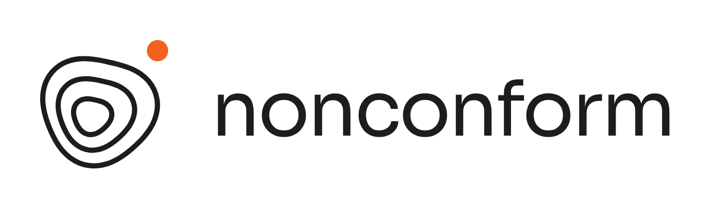
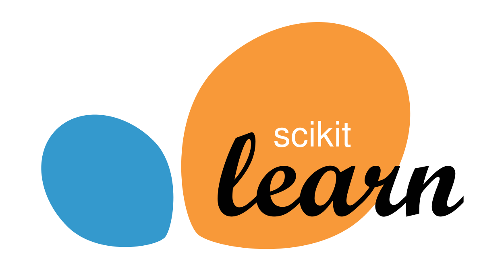
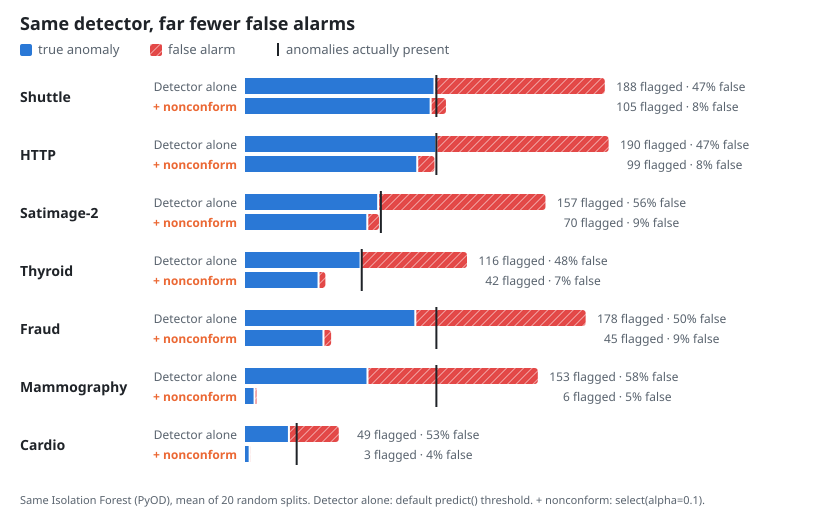

<h1 align="center">
  <a href="https://oliverhennhoefer.github.io/nonconform/">
    
  </a>
</h1>

<p align="center">
  <strong>Turn anomaly scores into flags with a false-alarm rate you set.</strong>
</p>

<p align="center">
  <a href="https://pypi.org/project/nonconform/"></a>
  <a href="https://pypi.org/project/nonconform/"></a>
  <a href="https://github.com/OliverHennhoefer/nonconform/actions/workflows/codecov.yml"></a>
  <a href="https://codecov.io/gh/OliverHennhoefer/nonconform"></a>
  <a href="https://oliverhennhoefer.github.io/nonconform/"></a>
  <a href="https://github.com/OliverHennhoefer/nonconform/blob/main/LICENSE"></a>
</p>

<p align="center">
  <a href="https://oliverhennhoefer.github.io/nonconform/">Documentation</a> ·
  <a href="https://oliverhennhoefer.github.io/nonconform/api/">API Reference</a> ·
  <a href="https://proceedings.mlr.press/v329/hennhofer26a.html">Paper</a>
</p>

---

**A detector ranks points by how unusual they look but leaves the cutoff to you.**
The usual default, flagging the top 10% of scores, is a guess about how many
anomalies there are. `nonconform` calibrates the scores of your existing detector
against normal data, so the threshold follows from the error rate you can accept.

<p align="center">
  <strong>Works with</strong>
  &nbsp;&nbsp;&nbsp;
  <a href="https://scikit-learn.org/"></a>
  &nbsp;&nbsp;&nbsp;&nbsp;
  <a href="https://pyod.readthedocs.io/"></a>
  &nbsp;&nbsp;&nbsp;&nbsp;
  <a href="https://oliverhennhoefer.github.io/nonconform/user_guide/detector_compatibility/"></a>
</p>

The same Isolation Forest on seven benchmark datasets, with and without `nonconform`:

<picture>
  <source media="(prefers-color-scheme: dark)" srcset="https://raw.githubusercontent.com/OliverHennhoefer/nonconform/main/docs/img/readme/flags-dark.svg">
  
</picture>

<sub><i>Isolation Forest from PyOD; "detector alone" uses its default <code>predict()</code> threshold, "+ nonconform" uses <code>select(alpha=0.1)</code>. Mean of 20 random splits per <a href="https://pypi.org/project/oddball/">benchmark dataset</a>. The average false share stays under the 10% target on every dataset; where the detector barely separates anomalies (Mammography, Cardio), <code>nonconform</code> flags little rather than guess. The baseline trains on every row, <code>nonconform</code> holds some back for calibration. Reproduce with <a href="https://github.com/OliverHennhoefer/nonconform/blob/main/examples/benchmarks/default_thresholds.py"><code>default_thresholds.py</code></a>.</i></sub>

## Installation

`nonconform` requires Python 3.11 or newer.

```bash
pip install nonconform
```

<details>
<summary><strong>Optional extras</strong></summary>

| Extra | Adds |
| --- | --- |
| `pyod` | PyOD anomaly detectors |
| `data` | `oddball` benchmark datasets and PyArrow support |
| `fdr` | Streaming FDR procedures from `online-fdr` |
| `probabilistic` | KDE-based probabilistic estimation and tuning |
| `all` | Every optional feature |

</details>

## Quick start

Wrap a detector, fit it on normal data, and select anomalies at a target false
discovery rate (FDR). The example loads a benchmark dataset, so it needs
`pip install "nonconform[data]"`:

```python
from oddball import Dataset, load
from sklearn.ensemble import IsolationForest

from nonconform import ConformalDetector, Split

# Normal-only training data; a labelled test batch with 10% anomalies
x_train, x_test, y_test = load(Dataset.SHUTTLE, setup=True, seed=0)

alpha = 0.1  # target FDR: on average at most 10% of flags are false
detector = ConformalDetector(
    detector=IsolationForest(random_state=0),
    strategy=Split(n_calib=1_000),  # normal rows held back for calibration
    seed=0,
).fit(x_train)

flagged = detector.select(x_test, alpha=alpha)  # Boolean mask
hits = int(y_test[flagged].sum())
print(f"Flagged {flagged.sum()} of {len(x_test)}, {hits} true anomalies")
# Flagged 105 of 1000, 95 true anomalies
```

Any PyOD model, a recognized scikit-learn estimator, or a
[custom detector](https://oliverhennhoefer.github.io/nonconform/user_guide/detector_compatibility/)
works in place of `IsolationForest`.

### Set a score threshold

To flag no more than 5% of normal points, certify a raw-score threshold instead:

```python
certificate = detector.fpr_bounds(confidence=0.95)
selected = certificate.select(detector.score_samples(x_test), target_fpr=0.05)
print(f"Certified threshold: {certificate.threshold_for(0.05)}")
```

With 95% probability over the calibration draw, the threshold flags at most 5%
of future normal points. Calibration and future normal scores must be i.i.d.;
targets below the certificate's band floor (about 3.85% for 1,000 calibration scores at 95% confidence) give
an infinite threshold. See
[raw-score false-alarm control](https://oliverhennhoefer.github.io/nonconform/user_guide/fdr_control/#raw-score-false-alarm-control).

### Monitor a stream

A fitted `Split` detector can start a sequential monitor that raises an alarm when
the data stops looking like the calibration set.

<details>
<summary><strong>Monitor a stream for change</strong></summary>

```python
import numpy as np
from sklearn.ensemble import IsolationForest

from nonconform import ConformalDetector, Split
from nonconform.martingales import AlarmConfig, SimpleJumperMartingale
from nonconform.monitoring import ExchangeabilityMonitor

rng = np.random.default_rng(42)
x_train = rng.normal(size=(1_000, 2))

detector = ConformalDetector(
    detector=IsolationForest(random_state=42),
    strategy=Split(n_calib=0.3),
    seed=42,
).fit(x_train)

alpha = 0.05
monitor = ExchangeabilityMonitor.from_split_detector(
    detector,
    martingale=SimpleJumperMartingale(
        alarm_config=AlarmConfig(restarted_ville_threshold=1 / alpha)
    ),
    seed=42,
)

# Stable observations followed by a distribution shift
x_stream = np.vstack([
    rng.normal(size=(50, 2)),
    rng.normal(loc=3.0, size=(50, 2)),
])

for x_t in x_stream:
    state = monitor.update(x_t)
    if "restarted_ville" in state.triggered_alarms:
        print(f"Change alarm at step {state.evidence_step}")
        break
```

</details>

Under the sequential validity assumptions, the restarted Ville alarm at
`1 / alpha` bounds the probability of ever raising a false alarm on one stream.
See the [sequential monitoring guide](https://oliverhennhoefer.github.io/nonconform/user_guide/exchangeability_martingales/).

## Choose a workflow

| Goal | Start with |
| --- | --- |
| Calibrate and select anomalies in a batch | [`Split` and `select(...)`](https://oliverhennhoefer.github.io/nonconform/quickstart/) |
| Set a per-inlier raw-score false-alarm target | [`fpr_bounds(...)` and FPR certificates](https://oliverhennhoefer.github.io/nonconform/user_guide/fdr_control/#raw-score-false-alarm-control) |
| Aggregate evidence across random splits | [`DerandomizedSplits` and e-BH](https://oliverhennhoefer.github.io/nonconform/examples/derandomized_e_values/) |
| Monitor a stream for change | [Exchangeability martingales](https://oliverhennhoefer.github.io/nonconform/user_guide/exchangeability_martingales/) |
| Reuse more data for fitting and calibration | [`CrossValidation` or `JackknifeBootstrap`](https://oliverhennhoefer.github.io/nonconform/user_guide/conformalization_strategies/) |
| Account for covariate shift | [Weighted conformal inference](https://oliverhennhoefer.github.io/nonconform/user_guide/weighted_conformal/) |
| Calibrate groups with different normal behavior | [Group-conditional (Mondrian) p-values](https://oliverhennhoefer.github.io/nonconform/user_guide/conformal_inference/#group-conditional-mondrian-p-values) |
| Certify realized FDP across p-value thresholds | [`fdp_bounds(...)` and FDP certificates](https://oliverhennhoefer.github.io/nonconform/user_guide/fdr_control/#post-hoc-simultaneous-fdp-bounds) |
| Bring a custom or third-party detector | [Detector compatibility](https://oliverhennhoefer.github.io/nonconform/user_guide/detector_compatibility/) |

## Coding agents

An [agent skill](https://github.com/OliverHennhoefer/nonconform/blob/main/plugins/nonconform/skills/nonconform/SKILL.md)
teaches coding agents to use `nonconform` without overclaiming. Install it in
Claude Code (`/plugin marketplace add OliverHennhoefer/nonconform`, then
`/plugin install nonconform@nonconform`) or Codex
(`codex plugin marketplace add OliverHennhoefer/nonconform`, then
`codex plugin add nonconform@nonconform`).

## Statistical scope

> [!IMPORTANT]
> Conformal inference needs remarkably little: no distributional model, and its
> guarantees hold in finite samples. The few assumptions it does make are worth
> knowing. Conformal p-values need calibration data and normal test points to be
> exchangeable; FDR claims need the assumptions of the chosen multiple-testing
> procedure; FPR certificates need i.i.d. scores from an independently fitted
> detector; weighted workflows need a credible covariate-shift model; Ville
> alarms cover one stream, while CUSUM and Shiryaev-Roberts thresholds need
> separate calibration.

`nonconform` calibrates detector scores; it cannot make an unsuitable detector
or a mismatched calibration set valid. Handle spatial or temporal dependence
before relying on exchangeability. Read the guides to
[FDR control](https://oliverhennhoefer.github.io/nonconform/user_guide/fdr_control/)
and [sequential monitoring](https://oliverhennhoefer.github.io/nonconform/user_guide/exchangeability_martingales/)
before applying a guarantee to a new problem.

## Citation

If you use `nonconform` in academic work, please cite the
[accompanying paper](https://proceedings.mlr.press/v329/hennhofer26a.html):

```bibtex
@inproceedings{Hennhoefer2026,
author = {Hennhöfer, Oliver and Kirsch, Maximilian and Preisach, Christine},
booktitle = {Proceedings of the Fifteenth Symposium on Conformal and Probabilistic Prediction with Applications},
pages = {613--632},
publisher = {PMLR},
title = {{Conformal Anomaly Detection in Python: Moving Beyond Heuristic Thresholds with nonconform}},
url = {https://proceedings.mlr.press/v329/hennhofer26a.html},
year = {2026}
}
```

## Project

Read the [documentation](https://oliverhennhoefer.github.io/nonconform/), browse
the [changelog](https://github.com/OliverHennhoefer/nonconform/blob/main/CHANGELOG.md),
or report a problem in the [issue tracker](https://github.com/OliverHennhoefer/nonconform/issues).
Contributions are welcome; start with the
[contributing guide](https://oliverhennhoefer.github.io/nonconform/contributing/).
`nonconform` is distributed under the
[BSD 3-Clause License](https://github.com/OliverHennhoefer/nonconform/blob/main/LICENSE).

<p align="center">
  <a href="https://www.dlr.de/">
    
  </a>
</p>
