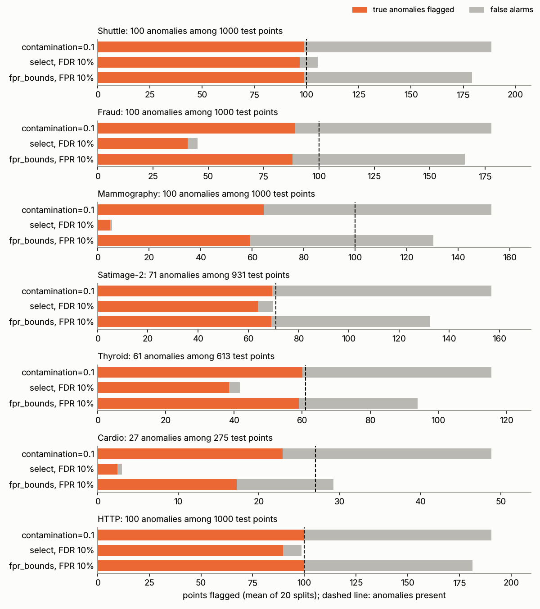

# How many of your anomaly flags are false?

PyOD detectors turn scores into flags with `contamination=0.1` by default:
flag the top 10% of scores. On seven standard benchmark datasets, an Isolation Forest
with that default flags about twice as many points as there are anomalies, and
**47 to 58% of its flags are false alarms**.

The default is not broken. It answers a different question than the one you
usually ask. This page shows the three rules side by side and when to use each.

## The setup

For each dataset, 20 random splits. Every split trains PyOD's `IForest` on
normal data only and scores a test set in which about 10% of the points are
anomalies. The datasets come from [`oddball`](https://pypi.org/project/oddball/)
(`pip install "nonconform[data]"`). Three rules turn the same kind of scores
into flags:

| Rule | Code | Promise |
|---|---|---|
| Default threshold | `IForest().fit(x).predict(x_test)` | None. Flags scores above the 90th percentile of the training scores |
| Short list | `ConformalDetector(...).select(x_test, alpha=0.1)` | On average, at most 10% of the flagged points are normal |
| Threshold | `detector.fpr_bounds(confidence=0.9)` with `target_fpr=0.1` | With 90% confidence, at most 10% of normal points get flagged |

```python
from oddball import Dataset, load
from pyod.models.iforest import IForest

from nonconform import ConformalDetector, Split

x_train, x_test, y_test = load(Dataset.SHUTTLE, setup=True, seed=0)

# Default threshold
flags_default = IForest(random_state=0).fit(x_train).predict(x_test)

# nonconform: one fitted detector, two rules
detector = ConformalDetector(
    detector=IForest(random_state=0),
    strategy=Split(n_calib=10_000),  # batch size / alpha
    seed=0,
).fit(x_train)
flags_list = detector.select(x_test, alpha=0.1)
certificate = detector.fpr_bounds(confidence=0.9)
flags_threshold = certificate.select(detector.score_samples(x_test), target_fpr=0.1)
```

The full script is
[`threshold_rules.py`](https://github.com/OliverHennhoefer/nonconform/blob/main/examples/benchmarks/threshold_rules.py).
It runs in about three minutes.

## Results



Share of flags that are false alarms (mean of 20 splits):

| Dataset | Anomalies / test points | `contamination=0.1` | `select`, FDR 10% | `fpr_bounds`, FPR 10% |
|---|---|---|---|---|
| Shuttle | 100 / 1,000 | 47% | 8% | 45% |
| Fraud | 100 / 1,000 | 50% | 9% | 47% |
| Mammography | 100 / 1,000 | 58% | 5% | 55% |
| Satimage-2 | 71 / 931 | 56% | 9% | 48% |
| Thyroid | 61 / 613 | 48% | 7% | 37% |
| Cardio | 27 / 275 | 53% | 4% | 41% |
| HTTP | 100 / 1,000 | 47% | 8% | 45% |

Share of anomalies found:

| Dataset | `contamination=0.1` | `select`, FDR 10% | `fpr_bounds`, FPR 10% |
|---|---|---|---|
| Shuttle | 99% | 97% | 99% |
| Fraud | 89% | 41% | 88% |
| Mammography | 64% | 5% | 59% |
| Satimage-2 | 98% | 90% | 98% |
| Thyroid | 99% | 63% | 97% |
| Cardio | 85% | 9% | 64% |
| HTTP | 100% | 90% | 100% |

## What the numbers say

**The default controls the wrong rate.** `contamination=0.1` flags close to 10%
of the normal points (9.8 to 10.4% here). With 900 normal points and 100
anomalies, 10% of the normal points is 90 false alarms, about as many as there
are anomalies. The rarer the anomalies, the worse this gets: at 1% anomalies,
the same rule would flag ten false alarms for every real one.

**`select` controls the rate you usually care about.** The share of false flags
stays under 10% on every dataset. Where the detector separates anomalies well
(Shuttle, Satimage-2, HTTP), it still finds 90% or more of them. Where it
barely does (Mammography, Cardio), `select` flags almost nothing rather than
hand you a list that is mostly wrong. An empty or short list is the honest
answer when the scores cannot back the promise.

**`fpr_bounds` is the certified version of the default.** It caps the same rate
the default aims at, the share of normal points flagged, but with a guarantee:
here it flagged 4.8 to 9.0% of normal points against a 10% target. Use it when
you need a fixed threshold that holds for every future point, or when `select`
finds nothing.

## Which rule to use

| You need | Use |
|---|---|
| A list to review, most of it real | `select(x, alpha=...)` |
| A fixed threshold with a known false-alarm rate | `fpr_bounds()` |
| A quick ranking with no promise | the detector's own scores |

Both nonconform rules need normal reference data for calibration, and they
assume that future normal points look like it. See
[Start here](start.md) for how much calibration data to hold out, and
[Assumptions and guarantees](guarantees.md) for what breaks the promises.

## Notes on the method

- The default threshold is fit on all training rows. nonconform withholds
  `n_calib` rows for calibration: `min(test size / alpha, half the training
  set)`, so the detector itself trains on fewer rows.
- All figures are means over 20 splits. A single split can do worse: the FDR
  promise holds on average over batches, not in each one.
- The test sets contain about 10% anomalies, which is generous to
  `contamination=0.1`. With rarer anomalies its false share rises further.
