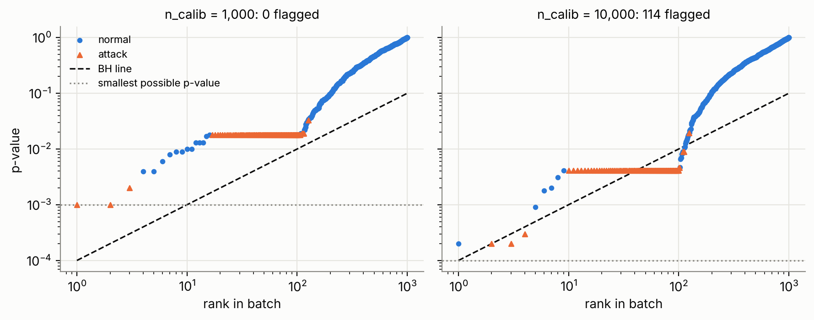

# Screen a batch for intrusions

[Open in Colab](https://colab.research.google.com/github/OliverHennhoefer/nonconform/blob/main/examples/batch_screening.ipynb) · [View notebook](https://github.com/OliverHennhoefer/nonconform/blob/main/examples/batch_screening.ipynb)

A thousand new network connections arrive and an analyst can review a short
list. On average, at most 10% of that list should be normal traffic. This is
`select(x, alpha=0.1)`.

The data is the HTTP subset of KDD Cup 99, loaded with `oddball`
(`pip install "nonconform[data]"`): about 280,000 normal connections for
reference and a batch of 1,000, of which 100 are attacks.

```python
import numpy as np
from oddball import Dataset, load
from sklearn.ensemble import IsolationForest

from nonconform import ConformalDetector, Split

x_reference, x_batch, y_batch = load(Dataset.HTTP, setup=True, seed=0)

alpha = 0.1
for n_calib in (1_000, int(np.ceil(len(x_batch) / alpha))):
    detector = ConformalDetector(
        detector=IsolationForest(random_state=0),
        strategy=Split(n_calib=n_calib),
        score_polarity="auto",
        seed=0,
    ).fit(x_reference)
    flagged = detector.select(x_batch, alpha=alpha)
    print(f"n_calib={n_calib:,}: flagged {flagged.sum()}")
```

| `n_calib` | Flagged | Normal among flagged | Attacks found |
|---|---|---|---|
| 1,000 | 0 | n/a | 0% |
| 10,000 | 114 | 13% | 99% |



Benjamini-Hochberg flags every point up to the last one below the dashed line.
The attacks in this batch are near-duplicates, so they share a handful of
p-values and are flagged all together or not at all. They make up 10% of the
batch, so at `alpha=0.1` their shared p-value must reach the dashed line at
rank 100, which is 0.01: they must score above all but 1% of the calibration
points. With 1,000 calibration scores they sit near 0.02 and nothing is
flagged. With 10,000, this fit puts them near 0.004 and they are all flagged.

That outcome depends on the fitted forest as much as on the calibration size.
Over 30 seeds, an empty list came up in 8 runs with 1,000 calibration scores
and in 2 runs with 10,000, and the share of attacks found averaged 73% and
93%. A larger calibration set makes an empty list rarer and gives finer
p-values, but it does not rule one out when the anomalies score only slightly
above the bulk of normal traffic.

13% normal traffic in this one list is not a broken promise: the 10% holds on
average over batches, not in every batch.

**Takeaways**

- Size the calibration set from the batch, as explained in
  [Start here](../start.md#how-much-calibration-data).
- An empty list means the evidence could not back the promise. If you need a
  rule for every point instead, use a
  [false-alarm threshold](false_alarm_threshold.md).
- The promise assumes clean reference data that resemble the batch's normal
  points. See [Assumptions and guarantees](../guarantees.md).
