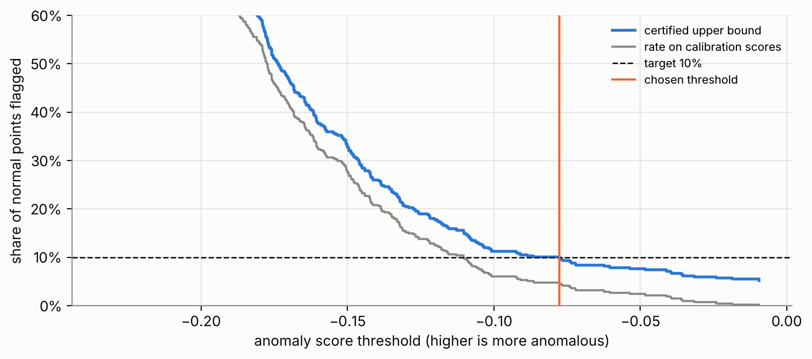

# Replace the contamination guess

[Open in Colab](https://colab.research.google.com/github/OliverHennhoefer/nonconform/blob/main/examples/false_alarm_threshold.ipynb) · [View notebook](https://github.com/OliverHennhoefer/nonconform/blob/main/examples/false_alarm_threshold.ipynb)

Most detectors turn scores into labels with `contamination`, a guess of the
share of anomalies. If the guess is off, so is the number of normal points you
flag. `fpr_bounds()` asks a question you can answer: what share of normal
points can you afford to flag?

The data is the Cardio dataset from `oddball`
(`pip install "nonconform[data]"`): 827 normal recordings for reference and a
test set of 275, of which 27 are pathological.

```python
from oddball import Dataset, load
from sklearn.ensemble import IsolationForest

from nonconform import ConformalDetector, Split

x_reference, x_test, y_test = load(Dataset.CARDIO, setup=True, seed=42)

# The usual way: guess the contamination
baseline = IsolationForest(contamination=0.1, random_state=42).fit(x_reference)
guessed = baseline.predict(x_test) == -1

# The nonconform way: cap the share of normal points flagged at 10%
detector = ConformalDetector(
    detector=IsolationForest(random_state=42),
    strategy=Split(n_calib=0.5),
    score_polarity="auto",
    seed=42,
).fit(x_reference)
certificate = detector.fpr_bounds(confidence=0.9)
certified = certificate.select(detector.score_samples(x_test), target_fpr=0.1)
```

| Rule | Flagged | Normal points flagged | Anomalies found |
|---|---|---|---|
| `contamination=0.1` | 55 | 12.5% | 89% |
| `fpr_bounds`, target 10% | 35 | 6.0% | 74% |
| `select(alpha=0.1)` | 0 | 0% | 0% |



The certificate bounds the false-alarm rate at every threshold at once (blue).
The chosen threshold is the lowest one whose bound stays under the target. The
bound sits above the rate seen on the calibration scores (grey), and the gap
shrinks as the calibration set grows.

`select` returns nothing here because the detector does not separate these
anomalies well enough to promise a list with at most 10% false entries. The
threshold makes a different promise, about normal points only, so it still
works.

**Takeaways**

- Use `fpr_bounds()` where you would set `contamination`. The target does not
  depend on how many anomalies arrive.
- A target needs enough calibration scores, see
  [Start here](../start.md#a-threshold-fpr_bounds).
- The bound assumes clean calibration data drawn independently from the same
  distribution as future normal points. See
  [Assumptions and guarantees](../guarantees.md).
