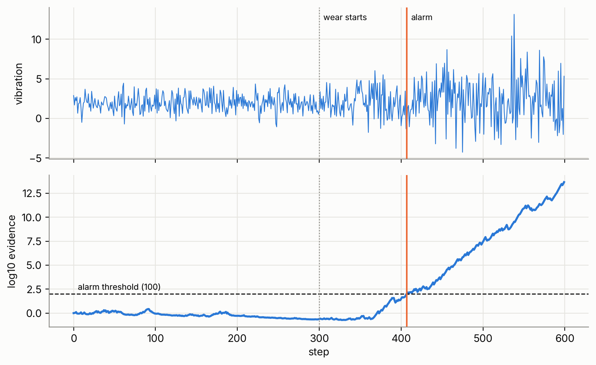

# Monitor a sensor stream

[Open in Colab](https://colab.research.google.com/github/OliverHennhoefer/nonconform/blob/main/examples/sensor_stream.ipynb) · [View notebook](https://github.com/OliverHennhoefer/nonconform/blob/main/examples/sensor_stream.ipynb)

A pump reports temperature, vibration and pressure at every step, and healthy
history is available. From step 300 a bearing wears and vibration grows slowly.
You want an alarm soon after the change, and a known, small chance of an alarm
while the pump is healthy.

`ExchangeabilityMonitor` turns each reading into a conformal p-value against
the healthy history and accumulates the evidence in a martingale. On a healthy
stream, the chance that it ever crosses a threshold of 100 is at most 1 in 100.

```python
import numpy as np
from sklearn.ensemble import IsolationForest

from nonconform import ConformalDetector, Split
from nonconform.martingales import AlarmConfig, SimpleJumperMartingale
from nonconform.monitoring import ExchangeabilityMonitor

rng = np.random.default_rng(42)


def pump_readings(n, wear):
    temperature = rng.normal(60.0, 1.5, n)
    vibration = 2.0 + rng.normal(0.0, 1.0, n) * (1.0 + wear)
    pressure = 5.0 + rng.normal(0.0, 0.2, n) + 0.05 * (temperature - 60.0)
    return np.column_stack([temperature, vibration, pressure])


history = pump_readings(2_000, wear=0.0)
wear = np.clip((np.arange(600) - 300) / 100, 0.0, None)
stream = pump_readings(600, wear=wear)

detector = ConformalDetector(
    detector=IsolationForest(random_state=42),
    strategy=Split(n_calib=0.5),
    score_polarity="auto",
    seed=42,
).fit(history)
monitor = ExchangeabilityMonitor.from_split_detector(
    detector,
    martingale=SimpleJumperMartingale(
        alarm_config=AlarmConfig(restarted_ville_threshold=100.0)
    ),
    seed=42,
)

for step, reading in enumerate(stream):
    if "restarted_ville" in monitor.update(reading).triggered_alarms:
        print(f"Alarm at step {step}")
        break
```



The evidence stays near zero while the pump is healthy and climbs once the
readings stop resembling the history. Here the alarm fires at step 407, about
100 steps into a slow degradation.

**Takeaways**

- A threshold of `1 / alpha` keeps the chance of a false alarm on one healthy
  stream at most `alpha`.
- An alarm says the stream changed, not which reading is anomalous. To flag
  points, [screen a batch](batch_screening.md).
- The promise needs healthy history that is exchangeable with a healthy stream,
  and a detector fitted before monitoring starts. See
  [Assumptions and guarantees](../guarantees.md). For alarm types and
  evaluation, see
  [Exchangeability martingales](../user_guide/exchangeability_martingales.md).
